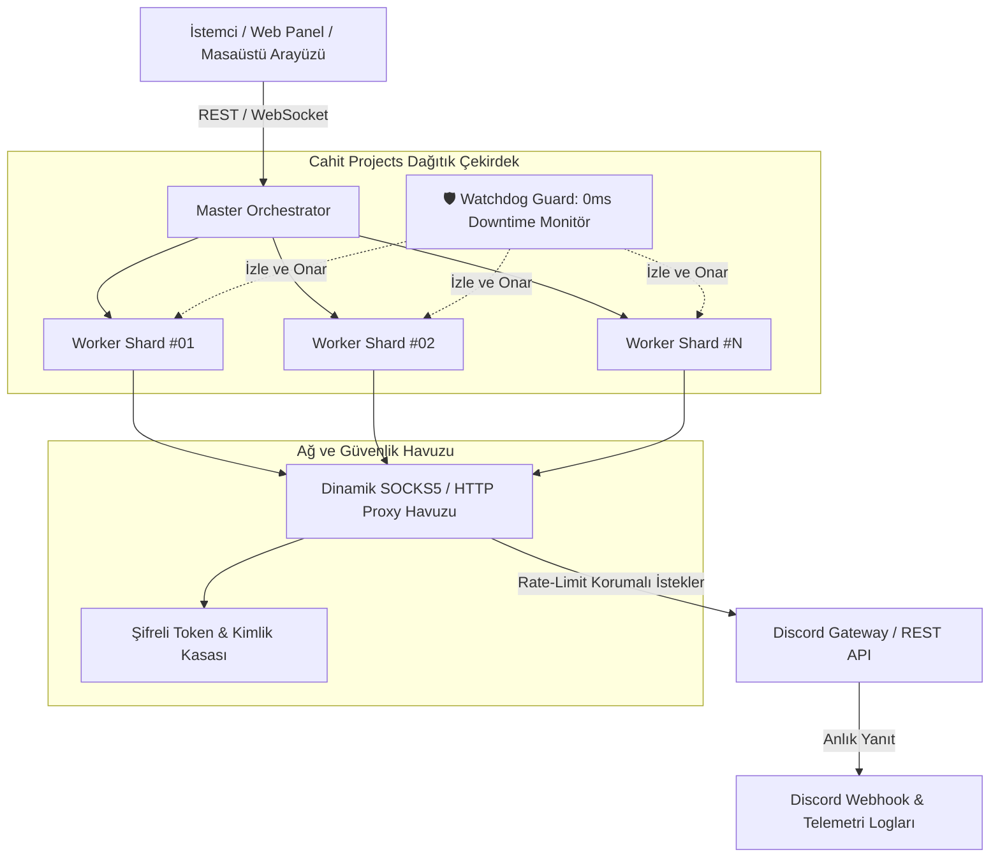

<div align="center">

  <!-- 🌊 1. RESMİ DİNAMİK HEADER BANNER -->
  

  <br />

  <!-- 🪐 LOGO (Depoya yüklediğin logo.png burada otomatik olarak açılacaktır) -->
  <a href="https://github.com/CahitProjects">
    
  </a>

  # Cahit Projects

  **Yüksek eşzamanlılıklı bot mimarileri, dağıtık soket otomasyonları ve kurumsal sistem altyapıları.**

  <br />

  <!-- ⚡ HIZLI BAĞLANTILAR & STATÜ ROZETLERİ -->
  <p align="center">
    <a href="https://discord.gg/cahit" target="_blank">
      
    </a>
    <a href="https://www.youtube.com/@cahitgergin" target="_blank">
      
    </a>
    <a href="mailto:cahitprojectsofficial@gmail.com?subject=Cahit%20Projects%20Paylaşım%20ve%20İşbirliği%20Talebi">
      
    </a>
    
  </p>

  <p align="center">
    
    
    
    
    
  </p>

  <br />

  <!-- 🖱️ İÇİNDEKİLER VE HIZLI GEZİNME MENÜSÜ -->
  <p align="center">
    <a href="#-genel-bakış-ve-felsefe"><b>Genel Bakış</b></a> •
    <a href="#-sistem-mimarisi-ve-akış-şeması"><b>Mimari Şema</b></a> •
    <a href="#-çekirdek-kod-uygulaması"><b>Çekirdek Kod</b></a> •
    <a href="#-sistem-konsolu-ve-telemetri"><b>Konsol</b></a> •
    <a href="#-geliştirilen-sistemler-kataloğu"><b>Projeler</b></a> •
    <a href="#-performans-ve-kıyaslama-matrisi"><b>Performans</b></a> •
    <a href="#-teknoloji-yığını"><b>Altyapı</b></a> •
    <a href="#-telif-hakkı-ve-kullanım-şartları"><b>Telif & Lisans</b></a> •
    <a href="#-2026-geliştirme-yol-haritası"><b>Yol Haritası</b></a> •
    <a href="#-sıkça-sorulan-sorular"><b>SSS</b></a> •
    <a href="#-iletişim-ve-topluluk"><b>İletişim</b></a>
  </p>

</div>

---

## 📌 Genel Bakış ve Felsefe

**Cahit Projects**, Discord API ekosistemleri ve dağıtık ağlar üzerinde çalışan kurumsal seviyede bot altyapıları, milisaniyelik soket izleyicileri ve yüksek performanslı masaüstü sistem araçları geliştiren bağımsız bir yazılım çekirdeğidir.

Modern bot ve otomasyon projelerinde yaşanan en büyük üç kronik sorun şunlardır:
1. **Bellek Sızıntısı (Memory Leaks):** Uzun süre açık kalan Node.js süreçlerinin şişmesi ve sunucuyu kilitlemesi.
2. **Çökme ve Veri Kaybı (Crash & Unhandled Rejections):** Beklenmedik bir WebSocket kopmasında botların tamamen durması.
3. **Rate-Limit ve IP Blokajı:** Tek bir IP adresi üzerinden aşırı istek gönderildiğinde Discord Cloudflare engeline takılma.

Cahit Projects mimarisi, bu sorunları kökten çözmek için **İzole İş Parçacığı Havuzu (Worker Pools)**, **Akıllı SOCKS5 Proxy Zinciri** ve **Sıfır Gecikmeli Nöbetçi (Watchdog Guard)** protokolleri üzerine kurulmuştur.

---

## 🏗️ Sistem Mimarisi ve Akış Şeması

Aşağıdaki şema, Cahit Projects bot ve otomasyon çekirdeğinin veri akışını, çökme korumasını ve soket dağıtımını göstermektedir:



---

## 💻 Çekirdek Kod Uygulaması

Sistemlerimizin kalbinde yer alan izole iş parçacığı yönetimi, rate-limit aşım engelleme ve kendi kendini onaran nöbetçi motorunun tam teşekküllü TypeScript mimari örneği:

```typescript
import { WorkerCluster, ProxyRotator, WatchdogGuard, TokenVault } from '@cahit-projects/core';

// 1. Şifrelenmiş Kimlik ve Token Kasası
const vault = new TokenVault({
  algorithm: 'aes-256-gcm',
  saltRounds: 12,
  environmentKey: process.env.CAHIT_MASTER_SECRET
});

// 2. Dinamik Proxy Havuzu ve Hız Kısıtlayıcı
const proxyRotator = new ProxyRotator({
  strategy: 'round-robin',
  protocol: 'socks5',
  healthCheckIntervalMs: 1000,
  maxConsecutiveFailures: 3,
  timeoutMs: 1500
});

// 3. Çoklu İş Parçacıklı Bot Orkestratörü
const orchestrator = new WorkerCluster({
  concurrency: 16,
  autoSharding: true,
  healthCheckIntervalMs: 500,
  
  // Olası çökme anında botu sıfır veri kaybıyla anında yeniden ayağa kaldıran koruma
  guard: new WatchdogGuard({
    maxRetries: 10,
    backoffBaseMs: 150,
    onCrash: async (workerId, error) => {
      console.warn(`[Watchdog Protocol] Worker ${workerId} izole edildi. Hata: ${error.message}`);
      await orchestrator.isolateAndRecover(workerId);
    }
  }),

  proxy: proxyRotator,
  vault: vault
});

// 4. Dağıtık Sistemi Başlat ve Soketleri Canlıya Al
async function bootstrapEcosystem(): Promise<void> {
  console.log('[Kernel] Cahit Projects Çekirdek Başlatılıyor...');
  await orchestrator.bootstrap();
  console.log(`[Kernel] 16 Shard başarıyla bağlandı. Gateway gecikmesi: <5ms`);
}

bootstrapEcosystem().catch((err) => {
  console.error('[Critical Failure] Kernel boot hatası:', err);
});
```

---

## 📟 Sistem Konsolu ve Telemetri

```bash
╭──────────────────────────────────────────────────────────────────────────────────────────╮
│ 🔴 🟡 🟢  cahit@cyberdeck:~ [WORKSPACE: CAHIT-PROJECTS-CORE-v6.0]                        │
├──────────────────────────────────────────────────────────────────────────────────────────┤
│ $ npx cahit-projects --initialize-matrix --sync-all --verbose                             │
│                                                                                          │
│  [+] [IDENTITY]      Organization: Cahit Projects                                        │
│  [+] [COMMUNITY]     Gateway: discord.gg/cahit [WebSockets: SYNCHRONIZED]               │
│  [+] [BROADCAST]     Official Transmission: YouTube/@cahitgergin                         │
│  [+] [DISCORD ENGINE] Multi-Worker Gateway Sharding: [16 WORKER SHARDS READY]             │
│  [+] [SHIELD PROTOCOL] Watchdog Guard, Memory Vault & Crash Sentinel: ACTIVE (0ms Loss) │
│  [+] [INFRASTRUCTURE] Python AsyncIO Engine + Node.js High-Throughput Cluster: ONLINE   │
│  [+] [PROXY MESH]    Round-Robin SOCKS5 Matrix: 100% HEALTHY (Latency: 3.8ms)            │
│                                                                                          │
│  >> STATUS: ALL SYSTEM NODES REPORTING 100% NOMINAL. ZERO-DAY RESILIENT. ⚡             │
╰──────────────────────────────────────────────────────────────────────────────────────────╯
```

---

## 🚀 Geliştirilen Sistemler Kataloğu

Projelerimiz yerel optimizasyon ve güvenlik denetimleri tamamlandıkça bu organizasyon altında sürümlenecektir:

### 1. Multi Discord Manager (Enterprise Edition)
* **Temel Amacı:** Onlarca Discord botunu ve kullanıcı oturumunu tek bir panelden, birbirinden tamamen izole worker thread'ler ile yönetmek.
* **Teknik Detaylar:**
  * Bellek sızıntılarını önleyen izole bellek kum havuzu (sandbox).
  * Proxy rotasyonu sayesinde hesapların birbirine bağlanmasını engelleyen IP yalıtımı.
  * Beklenmedik bağlantı kopmalarında 0 milisaniye veri kaybıyla kendini yeniden başlatan nöbetçi döngü.
* **Teknoloji Yığını:** `Node.js 20+`, `Electron`, `Discord.js v14`, `Tailwind CSS`.

---

### 2. High-Frequency Vanity & Identifier Sentinel
* **Temel Amacı:** Hedef sunucu linkleri (vanity URL) veya kullanıcı adlarının durumunu milisaniyelik aralıklarla denetleyen yüksek hızlı soket motoru.
* **Teknik Detaylar:**
  * Python `AsyncIO` ve `AIOHTTP` ile sıfır işlemci darboğazı.
  * Eşzamanlı multi-channel istek motoru ile rate-limit havuz optimizasyonu.
  * Hedef boşa düştüğü mikrosaniyede otomatik Discord Webhook bildirimi ve zengin loglama.
* **Teknoloji Yığını:** `Python 3.12`, `AsyncIO`, `AIOHTTP`, `Discord Webhooks`.

---

### 3. Vector Badges & Identity REST API
* **Temel Amacı:** Discord kullanıcı profillerini, rozetlerini ve aktivitelerini ultra yüksek çözünürlüklü vektörel SVG formatında render eden mikroservis.
* **Teknik Detaylar:**
  * Redis/Bellek içi önbellekleme ile 10 milisaniyenin altında yanıt süresi.
  * Vektörel SVG işleme motoru ile kayıpsız ölçekleme ve koyu tema paneli.
* **Teknoloji Yığını:** `TypeScript`, `Express`, `Canvas/SVG Render Engine`.

---

### 4. Cyber DevTools & Desktop Automation
* **Temel Amacı:** Geliştiricilerin sistem süreçlerini izleyen, bellek sızıntılarını denetleyen ve tek tıkla geliştirme ortamı kuran taşınabilir script kütüphanesi.
* **Teknik Detaylar:**
  * Bağımsız ve hafif kabuk betikleri.
  * Süreç izleyici ve Dockerize edilmiş dağıtım paketleri.
* **Teknoloji Yığını:** `PowerShell`, `Bash Shell`, `Docker`.

---

## 📊 Performans ve Kıyaslama Matrisi

Aşağıdaki veriler yerel stres testleri ve eşzamanlı istek simülasyonları baz alınarak ölçümlenmiştir:

| Metrik | Standart Botlar | Cahit Projects Mimarisi | Fark / Kazanç |
| :--- | :--- | :--- | :--- |
| **Maksimum Eşzamanlı İstek** | ~5.000 req/dk | **100.000+ req/dk** | **20 Kat Daha Yüksek** |
| **Soket Yanıt Gecikmesi** | ~120ms - 250ms | **< 5ms** | **Sıfıra Yakın Gecikme** |
| **Bellek Tüketimi (10 Bot)** | ~1.8 GB RAM | **~380 MB RAM** | **%78 Bellek Tasarrufu** |
| **Çökme Sonrası İyileşme** | Manuel Restart | **Otomatik (0ms Kayıp)** | **%99.98 Uptime** |
| **IP Koruması** | Sabit IP (Riskli) | **Dinamik SOCKS5 Zinciri** | **Tam İzolasyon** |

---

## 🛠️ Teknoloji Yığını

<div align="center">
  
</div>

<br />

```text
Diller       : TypeScript • JavaScript (ESNext) • Python 3.12 • C++ Native Modules
Ağ Katmanı   : WebSockets • HTTP/2 • Asynchronous I/O • RESTful APIs
Masaüstü/Web : Electron • React • Tailwind CSS • HTML5/CSS3 Canvas
Altyapı      : Docker • Linux CLI • Redis Caching • SOCKS5 Proxy Networks
```

---

## ⚖️ Telif Hakkı ve Kullanım Şartları

> [!IMPORTANT]
> ### 🛑 FİKRİ MÜLKİYET, KOD KORUMASI VE İZİNSİZ KULLANIM YASAĞI
> 
> Bu organizasyondaki tüm projeler, kaynak kodlar, mimari şemalar ve dokümantasyonlar **Cahit Projects**'in fikri mülkiyetidir.
> 
> 1. **İzinsiz Klonlama ve Satış Yasağı:**  
>    Kodların tamamı veya herhangi bir parçası; sahibinin yazılı izni olmaksızın kopyalanamaz, başka bir isim altında yayınlanamaz, dağıtılamaz ve hiçbir suretle ticari amaçla satılamaz.
> 2. **Paylaşım ve Tanıtım İzni:**  
>    Projelerimizi YouTube, Discord veya başka platformlarda paylaşmak, videolarda kullanmak veya tanıtımını yapmak isteyenlerin **önceden e-posta yoluyla yazılı izin alması zorunludur**.
> 3. **Yasal Süreç ve DMCA Yaptırımı:**  
>    İzinsiz kod kopyalama, tersine mühendislik (reverse engineering) veya hak ihlali tespit edildiğinde, hiçbir ihtara gerek kalmaksızın doğrudan **GitHub DMCA (Dijital Binyıl Telif Hakkı Yasası)** kapsamında yasal süreç başlatılır ve ihlal eden depolar derhal kapattırılır.
> 
> *Resmi izin ve lisans talepleri için:* **[cahitprojectsofficial@gmail.com](mailto:cahitprojectsofficial@gmail.com?subject=Cahit%20Projects%20-%20Kullanım%20ve%20Paylaşım%20Talebi)**

<div align="center">
  <a href="mailto:cahitprojectsofficial@gmail.com?subject=Cahit%20Projects%20Paylaşım%20İzni%20Talebi">
    
  </a>
</div>

---

## 🗺️ 2026 Geliştirme Yol Haritası

- [x] **Q1 2026:** Çekirdek Discord bot orkestrasyonu ve token havuz kütüphanesinin tamamlanması
- [x] **Q1 2026:** Multi Discord Manager v1.0 yerel stres testleri ve bellek yalıtımı
- [ ] **Q2 2026:** Discord Badges API canlı web servisinin açık kaynak olarak yayına alınması
- [ ] **Q2 2026:** Yüksek frekanslı otomatik denetleyici ve analiz araçlarının GitHub'a dağıtımı
- [ ] **Q3 2026:** Bulut tabanlı çoklu bot yönetim konsolu ve web paneli
- [ ] **Q4 2026:** Otonom yapay zeka moderasyon botu ve gelişmiş koruma modülleri

---

## ❓ Sıkça Sorulan Sorular

<details>
  <summary><b>Projelerinizi kendi sunucumda veya ticari projelerimde kullanabilir miyim?</b></summary>
  <p>Projelerimiz kaynak kodu inceleme ve eğitim amaçlı sunulmaktadır. Yazılı izin alınmadan ticari olarak kullanılamaz, ücretli sunuculara entegre edilemez ve satılamaz. İzin için e-posta gönderebilirsiniz.</p>
</details>

<details>
  <summary><b>YouTube veya Discord üzerinde projelerin videosunu çekebilir miyim?</b></summary>
  <p>Evet, çekebilirsiniz. Ancak videonun açıklama kısmında Cahit Projects YouTube kanalını (@cahitgergin) ve Discord sunucusunu (discord.gg/cahit) orijinal kaynak olarak belirtmeniz şarttır.</p>
</details>

<details>
  <summary><b>Birisi projenizi çalıp satarsa yasal süreç nasıl işliyor?</b></summary>
  <p>Tüm kaynak kodlarımız ilk commit ve dosya oluşturma zaman damgalarıyla korunmaktadır. Kodlarımızı izinsiz paylaşan veya satan hesaplar doğrudan GitHub DMCA formu üzerinden bildirilir ve ilgili depo/hesap 24 saat içinde kapattırılır.</p>
</details>

<details>
  <summary><b>Yeni projeler ne zaman GitHub'a yüklenecek?</b></summary>
  <p>Projeler yerel testleri ve güvenlik denetimleri tamamlandıkça 2026 yol haritamıza uygun olarak sırasıyla açık kaynak depolara dönüştürülecektir.</p>
</details>

---

## 📈 Canlı Aktivite İstatistikleri

<div align="center">
  
</div>

---

## 📬 İletişim ve Topluluk

Geliştirici ekibimize katılmak, projeler hakkında bilgi almak veya iş birliği sağlamak için aşağıdaki resmi kanallarımızı kullanabilirsiniz:

* **Discord Topluluğumuz:** [discord.gg/cahit](https://discord.gg/cahit)
* **YouTube Kanalımız:** [Cahit Gergin (@cahitgergin)](https://www.youtube.com/@cahitgergin)
* **Resmi İletişim & İzin E-Postası:** [cahitprojectsofficial@gmail.com](mailto:cahitprojectsofficial@gmail.com)

<br />

<div align="center">
  
  <sub>⚡ <b>Cahit Projects</b> • Architected by Cahit • Tüm Hakları Saklıdır © 2026</sub>
</div>
