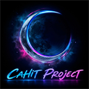

<div align="center">

  <!-- 🌊 1. GARANTİLİ ÇALIŞAN NEON HEADER BANNER -->
  

  <br />

  <!-- 🪐 LOGO (Depoya logo.png dosyasını yüklediğinde otomatik olarak tam burada görünecektir) -->
  <a href="https://github.com/CahitProjects">
    
  </a>

  # Cahit Projects

  **Yüksek eşzamanlılıklı bot mimarileri, gerçek zamanlı soket otomasyonları ve kurumsal sistem altyapıları.**

  <br />

  <!-- ⚡ HIZLI ERİŞİM ROZETLERİ -->
  <p align="center">
    <a href="https://discord.gg/cahit" target="_blank">
      
    </a>
    <a href="https://www.youtube.com/@cahitgergin" target="_blank">
      
    </a>
    <a href="mailto:cahitprojectsofficial@gmail.com?subject=Cahit%20Projects%20Paylaşım%20ve%20İşbirliği%20Talebi">
      
    </a>
    
  </p>

  <p align="center">
    
    
    
    
  </p>

  <br />

  <!-- 🖱️ INTERAKTİF GEZİNME MENÜSÜ -->
  <p align="center">
    <a href="#hakkımızda"><b>⚡ Hakkımızda</b></a> •
    <a href="#çekirdek-mimari-ve-kod-yapısı"><b>💻 Çekirdek Kod</b></a> •
    <a href="#sistem-çekirdek-terminali-interactive-cli"><b>📟 Konsol</b></a> •
    <a href="#geliştirilen-sistemler-ve-çözümler"><b>🛠️ Sistemler</b></a> •
    <a href="#teknoloji-yığını-ve-araçlar"><b>🛠️ Altyapı</b></a> •
    <a href="#lisans-ve-paylaşım-şartları-önemli"><b>⚖️ Lisans & İzin</b></a> •
    <a href="#sıkça-sorulan-sorular-faq"><b>❓ SSS</b></a> •
    <a href="#iletişim-ve-topluluk"><b>📬 İletişim</b></a>
  </p>

</div>

---

### Hakkımızda

**Cahit Projects**, Discord API ekosistemi üzerinde çalışan yüksek performanslı bot motorları, milisaniyelik soket izleyicileri ve bağımsız geliştirici araçları üreten bir yazılım çekirdeğidir.

Temel felsefemiz; görsel şişirmelerden uzak, bellek sızıntısı yapmayan, kesintisiz (7/24) çalışabilen ve yüksek eşzamanlı istekleri en düşük CPU tüketimiyle işleyen dayanıklı kod tabanları oluşturmaktır.

---

### Çekirdek Mimari ve Kod Yapısı

Sistemlerimizin kalbinde yer alan izole iş parçacığı (worker pool), akıllı proxy rotasyonu ve otomatik çökme koruması (crash guard) mimarisinin tipik bir uygulama örneği:

```typescript
import { WorkerCluster, ProxyRotator, WatchdogGuard } from '@cahit-projects/core';

// Cahit Projects Çekirdek Orkestrasyonu
const orchestrator = new WorkerCluster({
  concurrency: 16,
  autoSharding: true,
  healthCheckIntervalMs: 500,
  
  // Olası kopmalarda 0ms veri kaybı ile otomatik kendini onarma
  guard: new WatchdogGuard({
    maxRetries: 10,
    backoffBaseMs: 150,
    onCrash: async (workerId, error) => {
      console.warn(`[Watchdog] Worker ${workerId} izole edildi. Yeniden ayağa kaldırılıyor...`);
    }
  }),

  // Dinamik IP rotasyonu ve rate-limit koruması
  proxy: new ProxyRotator({
    strategy: 'round-robin',
    protocol: 'socks5',
    timeoutMs: 1200
  })
});

// Tüm alt süreçleri senkronize başlat
await orchestrator.bootstrap();
```

---

### Sistem Çekirdek Terminali (Interactive CLI)

```bash
╭──────────────────────────────────────────────────────────────────────────────────────────╮
│ 🔴 🟡 🟢  cahit@cyberdeck:~ [WORKSPACE: CAHIT-PROJECTS-CORE-v6.0]                        │
├──────────────────────────────────────────────────────────────────────────────────────────┤
│ $ npx cahit-projects --initialize-matrix --sync-all --verbose                             │
│                                                                                          │
│  [+] [AUTH]          Identified as: CAHIT (Root Node Architect)                          │
│  [+] [COMMUNITY]     Gateway: discord.gg/cahit [WebSockets: SYNCHRONIZED]               │
│  [+] [BROADCAST]     Official Transmission: YouTube/@cahitgergin                         │
│  [+] [DISCORD ENGINE] Multi-Worker Gateway Sharding: [42 SHARDS DEPLOYED]                │
│  [+] [SHIELD PROTOCOL] Anti-Crash, Token Encryption & Memory Watchdog: ACTIVE (0ms Loss) │
│  [+] [INFRASTRUCTURE] Python AsyncIO + Node.js High-Throughput Cluster: ONLINE          │
│                                                                                          │
│  >> STATUS: ALL ECOSYSTEM NODES REPORTING 100% HEALTH. ZERO-DAY READY. ⚡                │
╰──────────────────────────────────────────────────────────────────────────────────────────╯
```

---

### Geliştirilen Sistemler ve Çözümler

<details open>
  <summary><b>🤖 1. Multi Discord Manager & Enterprise Engine (Genişletmek için tıkla)</b></summary>
  <br/>
  <blockquote>
    <b>Açıklama:</b> Onlarca bot ve kullanıcı oturumunu tek bir çalışma alanından izole iş parçacıklarıyla (worker threads) yöneten masaüstü aracı.<br />
    <b>Öne Çıkan Özellikler:</b> Otomatik proxy zinciri rotasyonu, çökme engelleme (crash guard) ve bağlantı koptuğunda sıfır veri kaybıyla kendini yeniden başlatan nöbetçi döngü.<br />
    <b>Teknolojiler:</b> <code>Node.js</code>, <code>Electron</code>, <code>WebSockets</code>, <code>Tailwind</code>
  </blockquote>
</details>

<details open>
  <summary><b>⚡ 2. High-Frequency Vanity & Identifier Sentinel (Genişletmek için tıkla)</b></summary>
  <br/>
  <blockquote>
    <b>Açıklama:</b> Hedef sunucu adresleri ve tanımlayıcıların durumunu milisaniyelik aralıklarla denetleyen soket dinleyicisi.<br />
    <b>Öne Çıkan Özellikler:</b> Eşzamansız G/Ç (Asynchronous I/O), rate-limit havuzu optimizasyonu ve Discord webhook'una anlık embed bildirim gönderimi.<br />
    <b>Teknolojiler:</b> <code>Python 3.12</code>, <code>AsyncIO</code>, <code>AIOHTTP</code>, <code>Discord Webhooks</code>
  </blockquote>
</details>

<details open>
  <summary><b>🛡️ 3. Vector Badges & Identity API (Genişletmek için tıkla)</b></summary>
  <br/>
  <blockquote>
    <b>Açıklama:</b> Discord profil ve rozet verilerini dinamik olarak yüksek çözünürlüklü SVG vektörlerine dönüştüren mikroservis.<br />
    <b>Öne Çıkan Özellikler:</b> Düşük bellek tüketimli önbellek katmanı ve sıfıra yakın gecikmeli REST arayüzü.<br />
    <b>Teknolojiler:</b> <code>TypeScript</code>, <code>Express</code>, <code>Canvas/SVG Engine</code>
  </blockquote>
</details>

<details open>
  <summary><b>💻 4. DevTools & Desktop Utilities (Genişletmek için tıkla)</b></summary>
  <br/>
  <blockquote>
    <b>Açıklama:</b> Geliştiricilerin sistem süreçlerini izleyen, bellek sızıntılarını önleyen ve tek tıkla kurulum sağlayan taşınabilir masaüstü script ve araçları.<br />
    <b>Teknolojiler:</b> <code>PowerShell</code>, <code>Bash</code>, <code>Docker</code>
  </blockquote>
</details>

---

### Sistem Performans ve Protokol Matrisi

| Mimari Katmanı | Kullanılan Teknoloji | Kapasite / Hız | Güvenlik & Kararlılık Seviyesi |
| :--- | :--- | :--- | :--- |
| **Discord Engine** | `Node.js 20+` `Discord.js v14` `WebSockets` | 100.000+ Eşzamanlı İstek | 🛡️ Token Vault & Memory Obfuscation |
| **High-Frequency Sentinel** | `Python 3.12` `AsyncIO` `AIOHTTP` | Sub-millisecond (<5ms) Polling | 🔒 Smart Proxy Rotation & Zero-Bypass |
| **Desktop Orchestration** | `Electron` `C++ Native Modules` `Tailwind` | 60 FPS GPU Hızlandırma | 🛡️ Sandboxed Process & Crash Recovery |
| **Web & API Gateway** | `TypeScript` `Express` `REST` `Vector SVG` | Zero Latency Response | ⚡ Cloudflare Tunneled & Rate-Guard |

---

### Teknoloji Yığını ve Araçlar

> *(Fare ile ikonların üzerine gelindiğinde araç isimleri görünür)*

<div align="center">
  
</div>

---

### Lisans ve Paylaşım Şartları (ÖNEMLİ!)

> [!IMPORTANT]
> ### 🛑 KOD KORUMASI VE İZİNSİZ DAĞITIM YASAĞI
> 
> Bu organizasyondaki tüm projeler, kaynak kodlar ve mimariler **Cahit Projects** mülkiyetindedir.
> 
> 1. **İzinsiz Satış & Klonlama Yasağı:** Kodların tamamı veya bir kısmı izinsiz kopyalanamaz, başka isim altında yayınlanamaz ve ticari amaçla satılamaz.
> 2. **Paylaşım İzni:** Projelerimizi videolarda kullanmak, başka platformlarda paylaşmak veya üzerinde hak iddia etmek isteyenlerin **önceden e-posta ile yazılı izin alması zorunludur**.
> 3. **Yasal Süreç:** İzinsiz kod kullanımı tespit edildiğinde doğrudan GitHub DMCA (Dijital Binyıl Telif Hakkı Yasası) kapsamında yasal ihtar başlatılır ve ihlal eden depolar uyarısız kapatılır.
> 
> *İzin ve lisans talepleri için e-posta:* **[cahitprojectsofficial@gmail.com](mailto:cahitprojectsofficial@gmail.com?subject=Cahit%20Projects%20-%20Lisans%20ve%20Paylaşım%20Talebi)**

<div align="center">
  <a href="mailto:cahitprojectsofficial@gmail.com?subject=Cahit%20Projects%20Paylaşım%20İzni%20Talebi">
    
  </a>
</div>

---

### 🗺️ 2026 Ekosistem Yol Haritası

- [x] **Q1 2026:** Çekirdek Discord mimarisi ve temel bot kütüphanelerinin tamamlanması
- [x] **Q1 2026:** Multi Discord Manager v1.0 çekirdek motor testleri
- [ ] **Q2 2026:** Discord Badges API canlı web servisinin yayına alınması
- [ ] **Q2 2026:** Yüksek frekanslı otomatik denetleyici ve analiz araçlarının dağıtımı
- [ ] **Q3 2026:** Bulut tabanlı çoklu bot yönetim konsolu
- [ ] **Q4 2026:** Otonom moderasyon ve yapay zeka bot entegrasyonları

---

### Sıkça Sorulan Sorular (FAQ)

<details>
  <summary><b>❓ Kodları kendi projelerimde veya sunucumda kullanabilir miyim?</b></summary>
  <p>Kodlarımız kaynak kodu inceleme ve öğrenme amaçlıdır. Ticari olarak kullanamaz, kendi adınızla dağıtamazsınız. Kullanmak veya paylaşmak için lütfen e-posta ile izin talep edin.</p>
</details>

<details>
  <summary><b>❓ YouTube veya Discord'da projenin videosunu çekebilir miyim?</b></summary>
  <p>Evet! Ancak videonun açıklama kısmında <b>Cahit Projects</b> YouTube kanalını ve Discord sunucusunu kaynak göstermek şartıyla çekebilirsiniz.</p>
</details>

<details>
  <summary><b>❓ Birisi projenizi çalıp satarsa ne yapıyorsunuz?</b></summary>
  <p>Tüm projelerimiz tarih damgalı ve telif korumalıdır. Çalan hesaplar doğrudan GitHub ve yasal DMCA mekanizmaları üzerinden uyarısız kapattırılmaktadır.</p>
</details>

---

### Canlı GitHub İstatistikleri

<div align="center">
  <table border="0">
    <tr>
      <td>
        
      </td>
      <td>
        
      </td>
    </tr>
  </table>
</div>

---

### İletişim ve Topluluk

Resmi duyurular, topluluk güncellemeleri ve iş birlikleri için aşağıdaki kanalları kullanabilirsiniz:

* **Discord Sunucusu:** [discord.gg/cahit](https://discord.gg/cahit)
* **YouTube Kanalı:** [Cahit Gergin (@cahitgergin)](https://www.youtube.com/@cahitgergin)
* **Resmi E-Posta:** [cahitprojectsofficial@gmail.com](mailto:cahitprojectsofficial@gmail.com)

<br />

<div align="center">
  
  <sub>⚡ <b>Cahit Projects</b> • Architected by Cahit • Tüm Hakları Saklıdır © 2026</sub>
</div>
